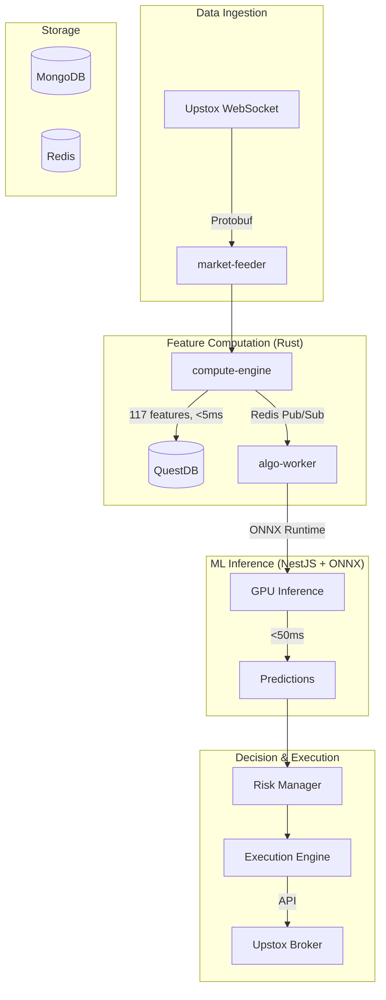
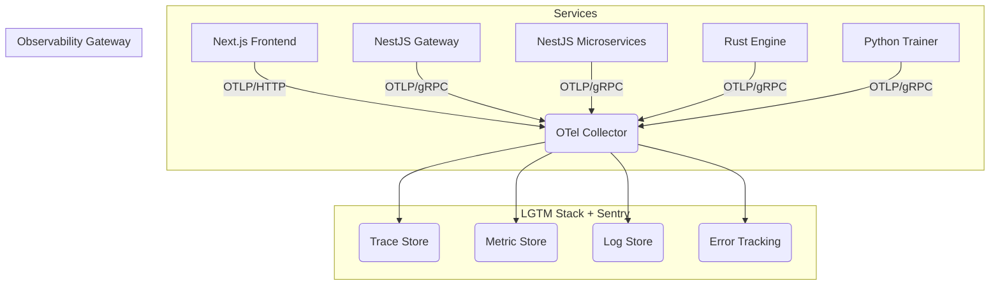

# Quantum Investments and Trades

> **Institutional-grade algorithmic trading + Professional wealth management for comprehensive financial sovereignty.**
> Event-Driven Architecture | Rust Feature Engine | ONNX Inference | SEBI 2024-2025 Compliant

---

## 🎯 What is Quantum Investments and Trades?

A comprehensive financial ecosystem combining two powerful systems:

### 1. **Algorithmic Trading Engine**

Battle-tested system for ultra-low latency NSE options trading with institutional-grade risk management.

### 2. **Professional Wealth Management** 🆕

State-of-the-art personal finance system with double-entry bookkeeping, AI-powered insights, and holistic financial planning.

---

## 🚀 Core Capabilities

### Algo Trading (algo-worker)

- **🧠 5-Tier Hierarchical AI Stack** (2026 State-of-the-Art):
  - **TIER 0**:
  - **TIER 1 - Base Prediction Models**:
    - **Micro-Alpha (10s-1min)**: LiT Transformer, TLOB for Depth-30 LOB microstructure
    - **Macro Direction (5min-1hr)**: LightGBM, XGBoost, PatchTST with 117 features
    - **Regime & Volatility**: TFT (Temporal Fusion Transformer), Mamba (State Space), TimeMixer
    - **Options-Specific**: IV Surface Predictor (VAE+MLP), Greeks Forecaster
  - **TIER 2 - Meta-Learner**: Attention-based signal fusion with regime-aware weighting
  - **TIER 3 - Strategy Layer**: Strike Selector (Neural Net), Risk Manager (Greeks + VaR)
  - **TIER 4 - Execution**: PPO Agent for slippage minimization (-5 to -10 bps)
  - **Multi-Horizon Predictions**: H1(10s) → H6(EOD) cascade as features
  - **Validation**: CPCV (Combinatorial Purged Cross-Validation)
  - **Drift Detection**: ADWIN for online model adaptation
  - **Feature Store**: Redis (direct writes) for training-serving consistency
  - **Explainability**: SHAP for SEBI compliance
- **⚡ Ultra-Low Latency**:
  - Event-driven core with deterministic sequencer (<10μs event processing)
  - Worker Threads for GPU inference (eliminates main-thread blocking)
  - ONNX Runtime with TensorRT/OpenVINO (FP16 quantization)
  - Object pooling + TypedArrays (eliminates GC pauses)
  - CPU pinning + lock-free data structures
- **🛡️ Institutional Risk Management**:
  - Real-time Greeks monitoring (Delta, Gamma, Vega, Theta)
  - Multi-criteria exits (stop loss, trailing stop, ML reversal, time-based, risk breach)
  - Kelly Criterion position sizing with VIX-scaled dynamic leverage
  - Automated circuit breakers (max loss, drawdown, latency degradation)
- **🚀 DRL PPO Execution Agent** 🆕 (Optional):
  - Learned optimal execution for slippage minimization (-5 to -10 bps improvement)
  - State: LOB snapshot, remaining qty, spread, volatility
  - Actions: Limit price offset, slice size, wait time
  - **Critical Rule**: ONLY execution optimization (never decides direction/strategy)
  - Safety: Fallback to TWAP/VWAP if agent underperforms

### Wealth Management (wealth-management, wealth-analyzer, document-processor) 🆕

- **💰 Double-Entry Ledger**:
  - Mathematically guaranteed balance (Assets = Liabilities + Equity + Income - Expenses)
  - Multi-account tracking (bank, demat, crypto, loans, insurance)
  - Real-time net worth with historical snapshots
  - Multi-currency support
- **🤖 AI-Powered Insights**:
  - Spending pattern analysis and anomaly detection
  - Investment performance recommendations
  - Predictive cash flow forecasting
  - Natural language queries (chat with your finances using Phi-3 LLM)
- **📊 Advanced Analytics**:
  - Net worth dashboard with waterfall visualization
  - Asset allocation sunburst charts
  - Cash flow analysis (income vs expense trends)
  - Investment returns (XIRR, CAGR by asset class)
  - Tax optimization (FY 2025-26 New Tax Regime vs Old Regime)
- **🔗 Automated Data Ingestion**:
  - Account Aggregator integration (Setu/Finvu - RBI compliant)
  - Bank statement parsing (AI-powered OCR with LayoutLMv3)
  - Zerodha Kite Connect (stocks, F&O auto-sync)
  - Crypto exchange APIs (Binance, WazirX)
  - Seamless integration with algo trading activity
- **📈 Financial Planning**:
  - Retirement planner (Monte Carlo simulations)
  - SIP goal tracker with corpus calculations
  - Emergency fund calculator (dynamic targets)
  - Loan optimizer (EMI vs prepayment analysis)
  - Insurance gap analysis

---

## 🏗️ Architecture

**Deployment Model**: Hybrid Local-Cloud

- **Cloud**: Web dashboard + API + config sync (Redis)
- **Local**: algo-worker (RTX GPU) + databases (QuestDB, MongoDB, Redis)
- **Why**: <100ms latency requires local execution, no cloud static IP compliance needed

**See [DEPLOYMENT_ARCHITECTURE.md](DEPLOYMENT_ARCHITECTURE.md) for full details.**

### Compute Engine (Rust/NAPI-RS)

**High-performance feature computation** - the critical bridge between market data and ML inference:

```
Upstox WS → market-feeder → compute-engine (Rust) → algo-worker (ONNX)
                              <5ms features          <50ms inference
```

- **117 Trading Features**: Index breadth, futures, options, volatility, order flow, momentum, regime, time context
- **Parallel Execution**: All features computed simultaneously via Rayon
- **Type Safety**: Rust types auto-generated to TypeScript via ts-rs
- **Performance**: <5ms total, ~150µs for parallel feature computation
- **Integration**: Used by both `market-feeder` (live) and `training-pipeline` (historical)

**See [compute-engine README](packages/compute-engine/README.md) for details.**



**See [ARCHITECTURE.md](docs/ARCHITECTURE.md) for detailed design.**

---

## Traceability & Instrumentation



## 🚀 Quick Start

### Prerequisites

- Node.js 20+
- Python 3.10+ (for ML training)
- Docker & Docker Compose
- CUDA 12+ (optional, for GPU inference)
- Upstox API credentials

### Installation

```bash
# 1. Clone and install
git clone <repo-url>
cd investment-trading-portfolio
pnpm install

# 2. Setup infrastructure
docker-compose up -d  # Starts QuestDB, MongoDB, Redis

# 3. Configure environment
cp apps/algo-worker/.env.example apps/algo-worker/.env
# Edit .env with Upstox credentials

# 4. Build shared packages
pnpm build --filter=@repo/schema
pnpm build --filter=@repo/database
pnpm build --filter=@repo/market-sdk

# 5. Run algo-worker
cd apps/algo-worker
pnpm dev  # Starts on port 3001
```

---

## 📚 Documentation

> **📁 All documentation organized by domain. See [docs/README.md](docs/README.md) for complete navigation guide.**

### 🎯 Quick Start Guides

- **[Developer Guide](docs/DEVELOPER_GUIDE.md)**: Development setup and workflow
- **[Architecture Overview](docs/ARCHITECTURE.md)**: System design philosophy
- **[Project Status](docs/PROJECT_STATUS.md)**: Implementation roadmap and gap analysis

### 🏗️ Core Architecture (docs/)

**System Design**:

- **[ARCHITECTURE.md](docs/ARCHITECTURE.md)**: Event-driven 9-layer system
- **[ALGO_TRADING_ARCHITECTURE.md](docs/ALGO_TRADING_ARCHITECTURE.md)**: Complete algo trading architecture
- **[DEPLOYMENT_ARCHITECTURE.md](docs/DEPLOYMENT_ARCHITECTURE.md)**: Hybrid local-cloud deployment
- **[SECURITY.md](docs/SECURITY.md)**: Security policies

**AI/ML Architecture (2026 State-of-the-Art)**:

- **[docs/ml/README.md](docs/ml/README.md)**: 📁 **Start here** - AI documentation index
- **[AI_TRADING_ARCHITECTURE.md](docs/ml/AI_TRADING_ARCHITECTURE.md)**: 5-tier hierarchical model architecture
- **[TIER1_MODELS.md](docs/ml/TIER1_MODELS.md)**: TFT, Mamba, PatchTST, LiT specifications with code
- **[META_LEARNER_EXECUTION.md](docs/ml/META_LEARNER_EXECUTION.md)**: Signal fusion, PPO execution agent
- **[TRAINING_PIPELINE.md](docs/ml/TRAINING_PIPELINE.md)**: CPCV validation, Kedro orchestration
- **[FEATURE_STORE.md](docs/ml/FEATURE_STORE.md)**: Redis + QuestDB for consistency

**Legacy AI Docs** (Reference Only):

- **[RESEARCH_FINDINGS.md](docs/RESEARCH_FINDINGS.md)**: Research insights
- **[AGENTIC_AI_RESEARCH.md](docs/AGENTIC_AI_RESEARCH.md)**: Multi-agent systems (R&D only)

### 🤖 Algo Trading (apps/algo-worker)

- **[Trading Engine](apps/algo-worker/README.md)**: 7-layer cognitive architecture
- **[PERFORMANCE_OPTIMIZATION.md](apps/algo-worker/docs/PERFORMANCE_OPTIMIZATION.md)**: Worker Threads, GPU, C++/Rust
- **[QUESTDB_UPSTOX_INTEGRATION.md](apps/algo-worker/docs/QUESTDB_UPSTOX_INTEGRATION.md)**: Market data
- **[Training Pipeline](services/training-pipeline/README.md)**: ML model training (Kedro + CPCV)

### 💰 Wealth Management (services/)

- **[Wealth Management](services/wealth-management/README.md)**: Double-entry ledger, net worth
  - [WEALTH_MANAGEMENT_SYSTEM.md](services/wealth-management/docs/WEALTH_MANAGEMENT_SYSTEM.md) - System guide
- **[Wealth Analyzer](services/wealth-analyzer/README.md)**: AI insights (Phi-3 LLM)
- **[Document Processor](services/document-processor/README.md)**: Bank statement parsing

### 🌐 Web & API (apps/)

- **[Web Dashboard](apps/web/README.md)**: Next.js 16 App Router
  - Trading Cockpit + Wealth Dashboard
- **[API Backend](apps/api/README.md)**: NestJS + tRPC
  - [TRPC_ARCHITECTURE.md](apps/api/docs/TRPC_ARCHITECTURE.md) - tRPC patterns
  - [NESTJS_CONFIG_PATTERN.md](apps/api/docs/NESTJS_CONFIG_PATTERN.md) - Config guide

### 🔧 Infrastructure (packages/ & infrastructure/)

- **[Database](packages/database/README.md)**: QuestDB + MongoDB + Redis
  - [MONGODB_REPLICA_SET.md](packages/database/docs/MONGODB_REPLICA_SET.md) - MongoDB setup
  - [SQL_QUERY_CENTRALIZATION.md](packages/database/docs/SQL_QUERY_CENTRALIZATION.md) - QuestDB patterns
- **[Market SDK](packages/market-sdk/README.md)**: Upstox/Yahoo/Binance
  - [UPSTOX_OAUTH_INTEGRATION.md](packages/market-sdk/docs/UPSTOX_OAUTH_INTEGRATION.md) - OAuth
- **[Infrastructure](infrastructure/docs/)**: Docker, deployment
  - [PORT_ALLOCATION.md](infrastructure/docs/PORT_ALLOCATION.md) - Port mapping

---

## 🔬 Research-Backed Decisions

This system is built on rigorous research from 2024-2025:

1.  **Event-Driven > Microservices** for HFT: Industry studies show deterministic event sequencers achieve lower latency than HTTP-based microservices communication[1].
2.  **QuestDB** for financial time-series: 2025 benchmark demonstrated 22x speed advantage over ClickHouse and 41x vs. TimescaleDB for OHLCV calculations[2].
3.  **ONNX Runtime + Execution Providers**: More flexible than standalone TensorRT while achieving near-native performance through hardware-specific EPs[3].
4.  **SEBI 2024-2025 Compliance**: New regulations mandate unique Algo IDs, pre-trade risk checks, and broker-level monitoring for all algorithmic strategies[4].

### Key References

- [1] "Deterministic Event-Driven Architecture for HFT" - Medium, 2024
- [2] "QuestDB vs TimescaleDB Benchmark" - Database Performance Study, 2025
- [3] "ONNX Runtime Execution Providers" - Microsoft AI Documentation
- [4] "SEBI Algorithmic Trading Guidelines 2024" - SEBI Official Circular

---

## 🛠️ Tech Stack

| Layer          | Technology                          | Why?                                 |
| -------------- | ----------------------------------- | ------------------------------------ |
| **Language**   | TypeScript (Core), Python (ML)      | Type safety + ML ecosystem           |
| **Backend**    | NestJS                              | Modular, production-grade            |
| **Frontend**   | Next.js 16                          | App Router, Server Components        |
| **Databases**  | QuestDB, MongoDB, Redis             | Validated for trading (see research) |
| **AI/ML**      | ONNX Runtime, PyTorch, Transformers | Cross-platform inference             |
| **Event Bus**  | Redis Streams                       | Sub-millisecond latency              |
| **Monitoring** | Prometheus, Grafana                 | Industry standard                    |

---

## 📈 Trading Strategies (Based on 2024 Indian Market Research)

- **9:20 Straddle** (Bank Nifty/Nifty): Time decay on non-trending days
- **Iron Condor**: High IV environments
- **Bollinger + RSI Mean Reversion**: Volatility exploitation
- **VWAP Reversal**: Intraday momentum
- **Sentiment-Driven Overnight Gaps**: Using FinBERT predictions

---

## 🔐 SEBI 2024-2025 Compliance

Every aspect of Project Quantum adheres to latest SEBI algorithmic trading norms:

- ✅ **Unique Algo ID**: Format `PROJ_QUANTUM_v{version}_USER_{userId}`
- ✅ **Pre-Trade Risk Checks**: Position limits, margin, exposure validated before EVERY order
- ✅ **Audit Trail**: All decisions logged to MongoDB with full context (5-year retention)
- ✅ **Broker Monitoring**: Integration with Upstox anomaly detection API
- ✅ **Exchange Registration**: Ready for NSE approval if order frequency >10/sec

---

## 🤝 Contributing

Please read **[Copilot Instructions](.github/copilot-instructions.md)** and consult with **[Agents](.github/agents/)** (Architect, Quant Researcher, Risk Manager, QA Engineer) before contributing.

### Development Principles

1.  **Event-Driven First**: All inter-service communication via Redis Streams
2.  **Latency Paranoia**: Profile EVERYTHING on the critical path
3.  **No Duplication**: Use `@repo/*` shared packages religiously
4.  **Safety Always**: Risk Manager has VETO power over AI

---

## 📊 Performance Targets

| Metric                      | Target | Status         |
| --------------------------- | ------ | -------------- |
| Tick-to-Trade Latency (p95) | <100ms | ⏳ In Progress |
| ML Inference (GPU)          | <50ms  | ⏳ In Progress |
| System Uptime               | >99.5% | ⏳ In Progress |
| Sharpe Ratio (Live)         | >1.5   | 🎯 Target      |
| Max Drawdown                | <15%   | 🎯 Target      |

---

**Built with ❤️ for the Indian Algo Trading Community**

**License**: Proprietary  
**Status**: Production-Ready Architecture (Implementation in Progress)  
**Last Updated**: March 13, 2026
