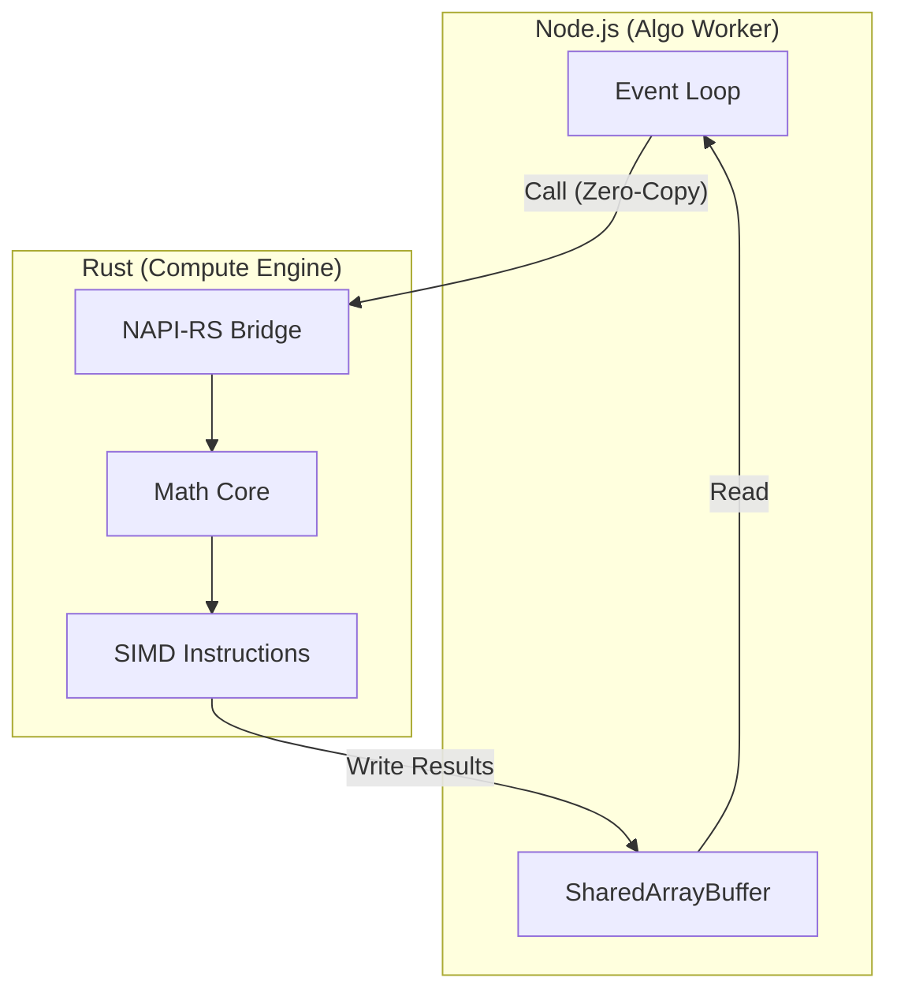

# Compute Engine Architecture

> **Design principles and structural overview of the high-performance math kernel.**

The Compute Engine is designed as a **hybrid module** that can function either as an embedded Node.js addon (via NAPI-RS) or as a standalone microservice. Its primary goal is to offload CPU-bound financial calculations from the main event loop of the `algo-worker`.

---

## 1. System Context

## 2. Integration Modes

### Mode A: Embedded (NAPI-RS) - **Primary**
In this mode, the Rust code is compiled into a dynamic library (`.node`) and loaded directly into the `algo-worker` process.

- **Communication**: Direct Foreign Function Interface (FFI).
- **Data Transfer**: Zero-copy via `Buffer` and `TypedArray`.
- **Latency**: < 10μs overhead per call.
- **Use Case**: Real-time tick processing, indicator calculation.

### Mode B: Standalone (Sidecar) - **Secondary**
Runs as a separate process, communicating via IPC or low-latency network protocols.

- **Communication**: gRPC or Redis Streams.
- **Data Transfer**: Protobuf / serialization required.
- **Latency**: > 500μs overhead.
- **Use Case**: Heavy batch jobs, volatility surface model training, backtesting replay.

## 3. Internal Components

### `IndicatorEngine`
Responsible for calculating sliding window technical indicators.
- **State**: Stateless (calculates on provided window) or Stateful (maintains internal ring buffers).
- **Optimization**: Uses incremental calculation algorithms where possible (e.g., rolling mean) to avoid re-scanning the entire window.

### `OptionsEngine`
Handles theoretical derivatives math and validation.
- **Pricing**: Black-Scholes-Merton (BSM) implementation for fair value estimation.
- **Theoretical Greeks**: Analytical derivation for risk simulations and surface modeling.
- **IV Solver**: Newton-Raphson algorithm for backing out Implied Volatility from price.

### `SurfaceModeler`
Constructs and queries the Volatility Surface.
- **Input**: Discrete (Strike, Expiry, IV) points.
- **Method**: Bilinear interpolation or SVI (Stochastic Volatility Inspired) parameterization.
- **Output**: IV for any arbitrary (Strike, Time).

## 4. Concurrency Model

Since the `algo-worker` is single-threaded (event loop), the Compute Engine handles parallelism internally:

- **Data Parallelism**: Uses `Rayon` for parallel iterators when processing large option chains (e.g., calculating Greeks for 500+ strikes simultaneously).
- **Task Parallelism**: Can offload heavy batch jobs to a dedicated thread pool (via `Tokio` in standalone mode) to prevent blocking the Node.js main thread even in NAPI mode (using `libuv` worker threads).

## 5. Memory Management

- **Zero-Allocation**: Hot paths are designed to avoid heap allocations (`Vec`, `Box`).
- **Views**: Uses `ndarray` views or slice references (`&[f64]`) over raw pointers for safety without copying.
- **Safety**: `unsafe` code is restricted to the NAPI boundary for buffer casting and verified with strict bounds checking.
