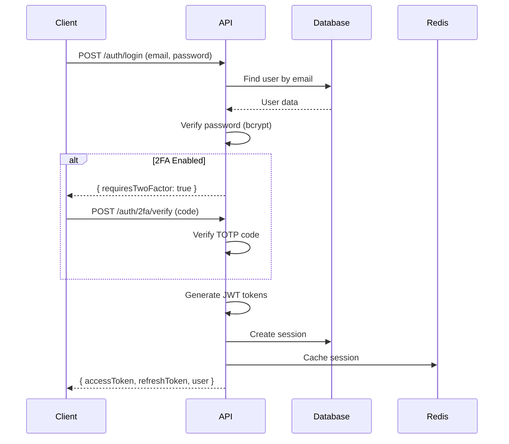
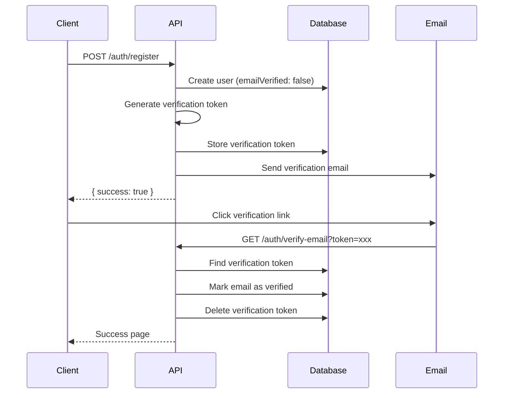

# Authentication Package Documentation

## Architecture

### Adapter Pattern

```
┌─────────────────────────────────────────┐
│         AuthService                     │
│   (Business Logic Layer)                │
├─────────────────────────────────────────┤
│              ↓ uses                     │
│    IAuthRepositories Interface          │
│  ┌─────────────────────────────────┐   │
│  │ - userRepository                │   │
│  │ - sessionRepository             │   │
│  │ - accountRepository             │   │
│  │ - verificationRepository        │   │
│  │ - twoFactorRepository           │   │
│  │ - passkeyRepository             │   │
│  └─────────────────────────────────┘   │
├─────────────────────────────────────────┤
│              ↓ implements               │
│     Database Adapters                   │
│  ┌─────────────────────────────────┐   │
│  │ MongoDBAdapter (Current)        │   │
│  │ PostgreSQLAdapter (Future)      │   │
│  │ SupabaseAdapter (Future)        │   │
│  └─────────────────────────────────┘   │
└─────────────────────────────────────────┘
```

## Authentication Flows

### Credentials Login Flow



### Registration + Email Verification



## Security Implementation

### Password Security

- **Algorithm**: bcrypt
- **Salt Rounds**: 12 (configurable)
- **Storage**: Hashed passwords only
- **Timing-safe comparison**: Built into bcrypt

### Token Security

```
Access Token (JWT):
├── Expiry: 15 minutes
├── Payload: userId, email, roles
├── Signature: HMAC SHA256
└── Secret: JWT_ACCESS_SECRET

Refresh Token (JWT):
├── Expiry: 7 days
├── Payload: userId, sessionId
├── Signature: HMAC SHA256
└── Secret: JWT_REFRESH_SECRET (different!)
```

### Session Management

```
Session Storage:
├── Primary: MongoDB (persistence)
│   ├── sessionId
│   ├── userId
│   ├── refreshToken
│   ├── expiresAt
│   ├── device info
│   └── IP address
│
└── Cache: Redis (fast lookups)
    ├── Key: session:{sessionId}
    ├── TTL: 7 days
    └── Value: Session object
```

## API Reference

See [API.md](API.md) for detailed endpoint documentation.

## Testing Strategy

### Unit Tests

- Service methods with mocked adapters
- Password hashing and verification
- Token generation and validation
- Input validation with Zod

### Integration Tests

- Database operations (MongoDB)
- Redis caching
- Email sending
- Session management

### E2E Tests

- Full authentication flows
- Registration → Verification → Login
- Password reset workflow
- 2FA enable/disable

## Performance Considerations

### Session Lookup Optimization

```typescript
// Fast path: Check Redis first
let session = await redis.get(`session:${sessionId}`);

if (!session) {
  // Slow path: Query MongoDB
  session = await sessionRepo.findById(sessionId);

  // Update cache
  if (session) {
    await redis.set(`session:${sessionId}`, session, "EX", 604800); // 7 days
  }
}
```

### Rate Limiting Strategy

```
Endpoints:
├── /auth/login: 5 req/min per IP
├── /auth/register: 3 req/hour per IP
├── /auth/forgot-password: 3 req/hour per IP
├── /auth/verify-email: 5 req/hour per token
└── /auth/2fa/*: 10 req/min per session
```

## Common Issues & Solutions

### Issue: "Invalid refresh token"

**Cause**: Token expired or session deleted
**Solution**: Force user to re-login

### Issue: "Email already exists"

**Cause**: Duplicate registration attempt
**Solution**: Check if email verified, resend verification if not

### Issue: "2FA code invalid"

**Cause**: Time sync issues, wrong code
**Solution**: Allow 2-step window, provide backup codes

## Migration Guide

### From Local Auth to OAuth

1. Keep existing user table
2. Add `Account` table for OAuth providers
3. Link accounts to users via `userId`
4. Update login flow to check both

### Adding New Database Adapter

1. Implement `IAuthRepositories` interface
2. Create adapter class
3. Register in `AdapterFactory`
4. Test all auth flows
5. Update documentation
