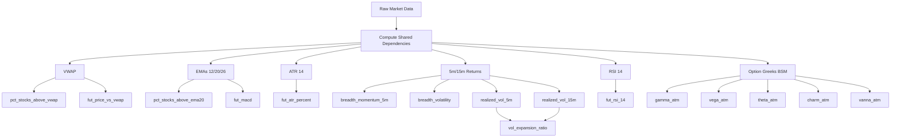

# Parallel Feature Computation Architecture

## Executive Summary

**Objective**: Transform compute-engine from model-based computation to a **parallel, dependency-aware feature computation system** that:

- Processes live tick data OR historical candle data
- Computes 33+ features in parallel with minimal redundancy
- Logs per-feature and total processing times
- Maintains end-to-end type safety (Rust ↔ TypeScript)
- Provides modular, extensible feature modules

---

## 1. Input Data Models

### 1.1 Live Tick Data (Real-Time)

```typescript
// From market-feeder WebSocket
interface LiveTickData {
  timestamp: Date
  niftyFuture: {
    ltp: number
    open: number
    high: number
    low: number
    close: number
    volume: number
    openInterest: number
    vwap: number
  }
  nifty50Constituents: Array<{
    symbol: string
    ltp: number
    open: number
    vwap: number
    volume: number
  }>
  options: Array<{
    strike: number
    type: 'CE' | 'PE'
    ltp: number
    iv: number
    delta: number
    gamma: number
    vega: number
    theta: number
    openInterest: number
    volume: number
  }>
  indiaVix: number | null
}
```

### 1.2 Historical Candle Data (Training)

```typescript
// From QuestDB (market_candles table)
interface CandleData {
  timestamp: Date
  instrumentKey: string // e.g., "NSE_INDEX|Nifty 50"
  intervalValue: number // 1, 5, 15, etc.
  intervalUnit: 'minute' | 'hour' | 'day'
  open: number
  high: number
  low: number
  close: number
  volume: number
  openInterest: number | null
}

// Batched for multi-instrument processing
interface CandleBatch {
  timestamp: Date
  candles: {
    niftyFuture: CandleData
    nifty50Constituents: CandleData[]
    options: CandleData[]
  }
  indiaVix: number | null
}
```

---

## 2. Feature Dependency Analysis

### 2.1 Shared Dependencies (Compute Once, Reuse Many)

| **Dependency**          | **Used By Features**                               | **Computation**                 |
| ----------------------- | -------------------------------------------------- | ------------------------------- |
| **VWAP**                | #1 (pct_stocks_above_vwap), #7 (fut_price_vs_vwap) | `Σ(price × volume) / Σ(volume)` |
| **EMA(20)**             | #2 (pct_stocks_above_ema20)                        | Exponential moving average      |
| **EMA(12), EMA(26)**    | #15 (fut_macd)                                     | MACD = EMA12 - EMA26            |
| **ATR(14)**             | #11 (fut_atr_percent)                              | Average true range              |
| **5-min Returns**       | #5 (breadth_momentum_5m), #6 (breadth_volatility)  | `(P_t - P_{t-5m}) / P_{t-5m}`   |
| **RSI(14)**             | #14 (fut_rsi_14)                                   | Relative strength index         |
| **Realized Vol (5m)**   | #28 (realized_vol_5m), #30 (vol_expansion_ratio)   | Σ(returns²)                     |
| **Realized Vol (15m)**  | #29 (realized_vol_15m), #30 (vol_expansion_ratio)  | Σ(returns²)                     |
| **Option Greeks (BSM)** | #19-21 (gamma/vega/theta), #25-26 (charm/vanna)    | Black-Scholes-Merton model      |

### 2.2 Dependency Graph



### 2.3 Computation Phases

**Phase 1: Shared Dependencies** (Sequential within phase, parallel across dependencies)

- VWAP calculation (for all instruments)
- EMA(12, 20, 26) calculation
- ATR(14) calculation
- 5-min and 15-min returns
- RSI(14) calculation
- Option Greeks (BSM)

**Phase 2: Parallel Feature Computation** (All features execute in parallel)

- Index Breadth Features (6)
- NIFTY Future Features (9)
- Option Aggregate Features (11)
- Volatility & Regime Features (4)
- Time Context Features (3)

---

## 3. Architecture Design

### 3.1 File Structure

```
packages/compute-engine/
├── src/
│   ├── lib.rs                    # NAPI entry point
│   ├── types.rs                  # TypeScript-compatible types (ts-rs)
│   ├── processor.rs              # Main orchestrator
│   ├── timer.rs                  # Performance logging
│   │
│   ├── dependencies/             # Shared calculations
│   │   ├── mod.rs
│   │   ├── vwap.rs               # VWAP computation
│   │   ├── ema.rs                # EMA computation
│   │   ├── atr.rs                # ATR computation
│   │   ├── returns.rs            # Period returns
│   │   ├── rsi.rs                # RSI computation
│   │   └── greeks.rs             # Black-Scholes Greeks
│   │
│   ├── features/
│   │   ├── mod.rs                # Feature trait + registry
│   │   │
│   │   ├── index_breadth/        # 6 features
│   │   │   ├── mod.rs
│   │   │   ├── pct_stocks_above_vwap.rs
│   │   │   ├── pct_stocks_above_ema20.rs
│   │   │   ├── weighted_return_top10.rs
│   │   │   ├── advance_decline_ratio.rs
│   │   │   ├── breadth_momentum_5m.rs
│   │   │   └── breadth_volatility.rs
│   │   │
│   │   ├── nifty_future/         # 9 features
│   │   │   ├── mod.rs
│   │   │   ├── fut_price_vs_vwap.rs
│   │   │   ├── fut_range_position.rs
│   │   │   ├── fut_return_1m.rs
│   │   │   ├── fut_return_5m.rs
│   │   │   ├── fut_atr_percent.rs
│   │   │   ├── fut_volume_zscore.rs
│   │   │   ├── fut_oi_change.rs
│   │   │   ├── fut_rsi_14.rs
│   │   │   └── fut_macd.rs
│   │   │
│   │   ├── options/              # 11 features
│   │   │   ├── mod.rs
│   │   │   ├── atm_iv.rs
│   │   │   ├── atm_iv_change.rs
│   │   │   ├── iv_skew.rs
│   │   │   ├── gamma_atm.rs
│   │   │   ├── vega_atm.rs
│   │   │   ├── theta_atm.rs
│   │   │   ├── pcr_oi.rs
│   │   │   ├── pcr_volume.rs
│   │   │   ├── max_pain_distance.rs
│   │   │   ├── charm_atm.rs
│   │   │   └── vanna_atm.rs
│   │   │
│   │   ├── volatility/           # 4 features
│   │   │   ├── mod.rs
│   │   │   ├── india_vix.rs
│   │   │   ├── realized_vol_5m.rs
│   │   │   ├── realized_vol_15m.rs
│   │   │   └── vol_expansion_ratio.rs
│   │   │
│   │   └── time_context/         # 3 features
│   │       ├── mod.rs
│   │       ├── minutes_from_open.rs
│   │       ├── minutes_to_close.rs
│   │       └── day_of_week.rs
│   │
│   └── cache/                    # Historical data cache
│       ├── mod.rs
│       └── rolling_window.rs
│
├── Cargo.toml
└── package.json
```

### 3.2 Core Abstractions

#### 3.2.1 Feature Trait

```rust
// src/features/mod.rs
use std::time::Instant;

pub trait Feature: Send + Sync {
    /// Feature name (for logging)
    fn name(&self) -> &'static str;

    /// Compute feature value
    fn compute(
        &self,
        input: &FeatureInput,
        deps: &ComputedDependencies,
    ) -> f64;
}

/// All computed shared dependencies
pub struct ComputedDependencies {
    pub vwap_future: f64,
    pub vwap_constituents: HashMap<String, f64>,
    pub ema12_future: f64,
    pub ema20_constituents: HashMap<String, f64>,
    pub ema26_future: f64,
    pub atr14_future: f64,
    pub returns_5m: Vec<f64>,
    pub returns_15m: Vec<f64>,
    pub rsi14_future: f64,
    pub greeks_atm: OptionGreeks,
}

/// Timing data for feature computation
pub struct FeatureTiming {
    pub feature_name: String,
    pub duration_micros: u64,
}

pub struct FeatureResult {
    pub features: HashMap<String, f64>,
    pub timings: Vec<FeatureTiming>,
    pub total_duration_micros: u64,
}
```

#### 3.2.2 Main Processor

```rust
// src/processor.rs
use rayon::prelude::*;
use std::time::Instant;

pub struct FeatureProcessor {
    features: Vec<Box<dyn Feature>>,
}

impl FeatureProcessor {
    pub fn new() -> Self {
        let mut features: Vec<Box<dyn Feature>> = Vec::new();

        // Register all features
        features.push(Box::new(PctStocksAboveVwap));
        features.push(Box::new(PctStocksAboveEma20));
        features.push(Box::new(WeightedReturnTop10));
        // ... register all 117 features

        Self { features }
    }

    /// Main entry point: compute all features
    pub fn compute_all(
        &self,
        input: &FeatureInput,
        cache: &HistoricalCache,
    ) -> FeatureResult {
        let start = Instant::now();

        // Phase 1: Compute shared dependencies (sequential)
        let dep_start = Instant::now();
        let deps = self.compute_dependencies(input, cache);
        let dep_duration = dep_start.elapsed();

        // Phase 2: Compute features in parallel
        let feature_results: Vec<(String, f64, u64)> = self.features
            .par_iter()
            .map(|feature| {
                let feature_start = Instant::now();
                let value = feature.compute(input, &deps);
                let duration = feature_start.elapsed().as_micros() as u64;
                (feature.name().to_string(), value, duration)
            })
            .collect();

        // Build result
        let mut features = HashMap::new();
        let mut timings = Vec::new();

        for (name, value, duration) in feature_results {
            features.insert(name.clone(), value);
            timings.push(FeatureTiming {
                feature_name: name,
                duration_micros: duration,
            });
        }

        // Add dependency computation timing
        timings.push(FeatureTiming {
            feature_name: "shared_dependencies".to_string(),
            duration_micros: dep_duration.as_micros() as u64,
        });

        FeatureResult {
            features,
            timings,
            total_duration_micros: start.elapsed().as_micros() as u64,
        }
    }

    fn compute_dependencies(
        &self,
        input: &FeatureInput,
        cache: &HistoricalCache,
    ) -> ComputedDependencies {
        // Compute all shared values once
        ComputedDependencies {
            vwap_future: compute_vwap(&input.nifty_future, cache),
            vwap_constituents: input.constituents
                .iter()
                .map(|c| (c.symbol.clone(), compute_vwap(c, cache)))
                .collect(),
            ema12_future: compute_ema(&input.nifty_future, 12, cache),
            ema20_constituents: input.constituents
                .iter()
                .map(|c| (c.symbol.clone(), compute_ema(c, 20, cache)))
                .collect(),
            ema26_future: compute_ema(&input.nifty_future, 26, cache),
            atr14_future: compute_atr(&input.nifty_future, 14, cache),
            returns_5m: compute_returns(&input.nifty_future, 5, cache),
            returns_15m: compute_returns(&input.nifty_future, 15, cache),
            rsi14_future: compute_rsi(&input.nifty_future, 14, cache),
            greeks_atm: compute_atm_greeks(&input.options, input.nifty_future.ltp),
        }
    }
}
```

---

## 4. Type Safety (Rust ↔ TypeScript)

### 4.1 Input Types

```rust
// src/types.rs
use napi_derive::napi;
use serde::{Deserialize, Serialize};
use ts_rs::TS;

#[napi(object)]
#[derive(Debug, Clone, Serialize, Deserialize, TS)]
#[ts(export, export_to = "../../packages/schema/src/compute-engine/")]
pub struct FeatureInput {
    pub timestamp: i64,
    pub nifty_future: FutureTick,
    pub constituents: Vec<ConstituentTick>,
    pub options: Vec<OptionTick>,
    pub india_vix: Option<f64>,
}

#[napi(object)]
#[derive(Debug, Clone, Serialize, Deserialize, TS)]
#[ts(export, export_to = "../../packages/schema/src/compute-engine/")]
pub struct FutureTick {
    pub ltp: f64,
    pub open: f64,
    pub high: f64,
    pub low: f64,
    pub close: f64,
    pub volume: f64,
    pub open_interest: f64,
    // VWAP is computed from historical cache, not provided
}

#[napi(object)]
#[derive(Debug, Clone, Serialize, Deserialize, TS)]
#[ts(export, export_to = "../../packages/schema/src/compute-engine/")]
pub struct ConstituentTick {
    pub symbol: String,
    pub ltp: f64,
    pub open: f64,
    pub volume: f64,
    // VWAP is computed from historical cache, not provided
}

#[napi(object)]
#[derive(Debug, Clone, Serialize, Deserialize, TS)]
#[ts(export, export_to = "../../packages/schema/src/compute-engine/")]
pub struct OptionTick {
    pub strike: f64,
    pub option_type: String, // "CE" or "PE"
    pub ltp: f64,
    pub iv: f64,
    pub delta: f64,
    pub gamma: f64,
    pub vega: f64,
    pub theta: f64,
    pub open_interest: f64,
    pub volume: f64,
}
```

### 4.2 Output Types

```rust
#[napi(object)]
#[derive(Debug, Clone, Serialize, Deserialize, TS)]
#[ts(export, export_to = "../../packages/schema/src/compute-engine/")]
pub struct FeatureOutput {
    pub timestamp: i64,

    // Index Breadth (6)
    pub pct_stocks_above_vwap: f64,
    pub pct_stocks_above_ema20: f64,
    pub weighted_return_top10: f64,
    pub advance_decline_ratio: f64,
    pub breadth_momentum_5m: f64,
    pub breadth_volatility: f64,

    // NIFTY Future (9)
    pub fut_price_vs_vwap: f64,
    pub fut_range_position: f64,
    pub fut_return_1m: f64,
    pub fut_return_5m: f64,
    pub fut_atr_percent: f64,
    pub fut_volume_zscore: f64,
    pub fut_oi_change: f64,
    pub fut_rsi_14: f64,
    pub fut_macd: f64,

    // Options (11)
    pub atm_iv: f64,
    pub atm_iv_change: f64,
    pub iv_skew: f64,
    pub gamma_atm: f64,
    pub vega_atm: f64,
    pub theta_atm: f64,
    pub pcr_oi: f64,
    pub pcr_volume: f64,
    pub max_pain_distance: f64,
    pub charm_atm: f64,
    pub vanna_atm: f64,

    // Volatility (4)
    pub india_vix: f64,
    pub realized_vol_5m: f64,
    pub realized_vol_15m: f64,
    pub vol_expansion_ratio: f64,

    // Time Context (3)
    pub minutes_from_open: i32,
    pub minutes_to_close: i32,
    pub day_of_week: i32,
}

#[napi(object)]
#[derive(Debug, Clone, Serialize, Deserialize, TS)]
#[ts(export, export_to = "../../packages/schema/src/compute-engine/")]
pub struct FeatureTimingLog {
    pub feature_name: String,
    pub duration_micros: u64,
}

#[napi(object)]
#[derive(Debug, Clone, Serialize, Deserialize, TS)]
#[ts(export, export_to = "../../packages/schema/src/compute-engine/")]
pub struct ComputeResult {
    pub features: FeatureOutput,
    pub timings: Vec<FeatureTimingLog>,
    pub total_duration_micros: u64,
}
```

### 4.3 Zod Schema (TypeScript Side)

```typescript
// packages/schema/src/compute-engine/feature-computation.schema.ts
import { z } from 'zod'

// Auto-generated by ts-rs, but add Zod validation
export const FeatureOutputSchema = z.object({
  timestamp: z.number().int(),

  // Index Breadth
  pct_stocks_above_vwap: z.number().min(0).max(1),
  pct_stocks_above_ema20: z.number().min(0).max(1),
  weighted_return_top10: z.number(),
  advance_decline_ratio: z.number().nonnegative(),
  breadth_momentum_5m: z.number(),
  breadth_volatility: z.number().nonnegative(),

  // ... (all 117 features)

  // Time Context
  minutes_from_open: z.number().int().min(0).max(390),
  minutes_to_close: z.number().int().min(0).max(390),
  day_of_week: z.number().int().min(0).max(4),
})

export type FeatureOutput = z.infer<typeof FeatureOutputSchema>

export const ComputeResultSchema = z.object({
  features: FeatureOutputSchema,
  timings: z.array(
    z.object({
      feature_name: z.string(),
      duration_micros: z.number().int().nonnegative(),
    }),
  ),
  total_duration_micros: z.number().int().nonnegative(),
})

export type ComputeResult = z.infer<typeof ComputeResultSchema>
```

---

## 5. Performance Logging

### 5.1 Rust Side (Structured Logs)

```rust
// src/timer.rs
use serde_json::json;

pub fn log_feature_timings(result: &FeatureResult) {
    // Log individual features
    for timing in &result.timings {
        println!(
            "{}",
            json!({
                "level": "info",
                "message": "feature_computed",
                "feature": timing.feature_name,
                "duration_micros": timing.duration_micros,
                "duration_ms": timing.duration_micros as f64 / 1000.0,
            })
        );
    }

    // Log total
    println!(
        "{}",
        json!({
            "level": "info",
            "message": "all_features_computed",
            "total_duration_micros": result.total_duration_micros,
            "total_duration_ms": result.total_duration_micros as f64 / 1000.0,
            "feature_count": result.features.len(),
        })
    );
}
```

### 5.2 TypeScript Integration (market-feeder/algo-worker)

```typescript
// services/market-feeder/src/feature-computation/compute-engine.service.ts
import { computeFeatures } from '@repo/compute-engine'
import { Logger } from '@nestjs/common'

export class ComputeEngineService {
  private readonly logger = new Logger(ComputeEngineService.name)

  async processTickData(tickData: LiveTickData): Promise<FeatureOutput> {
    const result = computeFeatures(tickData)

    // Log to structured logger
    this.logger.log({
      event: 'features_computed',
      total_duration_ms: result.total_duration_micros / 1000,
      feature_count: result.timings.length,
      slowest_features: result.timings
        .sort((a, b) => b.duration_micros - a.duration_micros)
        .slice(0, 5)
        .map((t) => ({
          name: t.feature_name,
          duration_ms: t.duration_micros / 1000,
        })),
    })

    return result.features
  }
}
```

---

## 6. Historical Data Cache

### 6.1 Rolling Window Cache

```rust
// src/cache/rolling_window.rs
use std::collections::VecDeque;

pub struct RollingWindow<T> {
    capacity: usize,
    data: VecDeque<T>,
}

impl<T: Clone> RollingWindow<T> {
    pub fn new(capacity: usize) -> Self {
        Self {
            capacity,
            data: VecDeque::with_capacity(capacity),
        }
    }

    pub fn push(&mut self, value: T) {
        if self.data.len() >= self.capacity {
            self.data.pop_front();
        }
        self.data.push_back(value);
    }

    pub fn get(&self, index: usize) -> Option<&T> {
        self.data.get(index)
    }

    pub fn as_slice(&self) -> Vec<&T> {
        self.data.iter().collect()
    }

    pub fn len(&self) -> usize {
        self.data.len()
    }
}

pub struct HistoricalCache {
    // Future prices (for EMA, ATR, RSI)
    future_prices: RollingWindow<f64>,
    future_highs: RollingWindow<f64>,
    future_lows: RollingWindow<f64>,
    future_volumes: RollingWindow<f64>,

    // Constituent prices (for EMA)
    constituent_prices: HashMap<String, RollingWindow<f64>>,

    // Options (for IV change)
    atm_ivs: RollingWindow<f64>,
}

impl HistoricalCache {
    pub fn new(lookback_periods: usize) -> Self {
        Self {
            future_prices: RollingWindow::new(lookback_periods),
            future_highs: RollingWindow::new(lookback_periods),
            future_lows: RollingWindow::new(lookback_periods),
            future_volumes: RollingWindow::new(lookback_periods),
            constituent_prices: HashMap::new(),
            atm_ivs: RollingWindow::new(lookback_periods),
        }
    }

    pub fn update(&mut self, input: &FeatureInput) {
        self.future_prices.push(input.nifty_future.ltp);
        self.future_highs.push(input.nifty_future.high);
        self.future_lows.push(input.nifty_future.low);
        self.future_volumes.push(input.nifty_future.volume);

        for constituent in &input.constituents {
            self.constituent_prices
                .entry(constituent.symbol.clone())
                .or_insert_with(|| RollingWindow::new(26))
                .push(constituent.ltp);
        }

        if let Some(atm_option) = input.options.first() {
            self.atm_ivs.push(atm_option.iv);
        }
    }
}
```

---

## 7. Example Feature Implementation

### 7.1 Simple Feature (No Dependencies)

```rust
// src/features/time_context/minutes_from_open.rs
use crate::features::Feature;
use chrono::{DateTime, Utc, Timelike};

pub struct MinutesFromOpen;

impl Feature for MinutesFromOpen {
    fn name(&self) -> &'static str {
        "minutes_from_open"
    }

    fn compute(
        &self,
        input: &FeatureInput,
        _deps: &ComputedDependencies,
    ) -> f64 {
        let dt = DateTime::<Utc>::from_timestamp(input.timestamp, 0)
            .unwrap();

        let market_open_minutes = 9 * 60 + 15; // 9:15 AM
        let current_minutes = dt.hour() * 60 + dt.minute();

        (current_minutes - market_open_minutes) as f64
    }
}
```

### 7.2 Dependency-Based Feature

```rust
// src/features/index_breadth/pct_stocks_above_vwap.rs
use crate::features::Feature;

pub struct PctStocksAboveVwap;

impl Feature for PctStocksAboveVwap {
    fn name(&self) -> &'static str {
        "pct_stocks_above_vwap"
    }

    fn compute(
        &self,
        input: &FeatureInput,
        deps: &ComputedDependencies,
    ) -> f64 {
        let total = input.constituents.len() as f64;
        let above_vwap = input.constituents.iter()
            .filter(|c| {
                if let Some(vwap) = deps.vwap_constituents.get(&c.symbol) {
                    c.ltp > *vwap
                } else {
                    false
                }
            })
            .count() as f64;

        above_vwap / total
    }
}
```

### 7.3 Complex Feature (Multiple Dependencies)

```rust
// src/features/volatility/vol_expansion_ratio.rs
use crate::features::Feature;

pub struct VolExpansionRatio;

impl Feature for VolExpansionRatio {
    fn name(&self) -> &'static str {
        "vol_expansion_ratio"
    }

    fn compute(
        &self,
        input: &FeatureInput,
        deps: &ComputedDependencies,
    ) -> f64 {
        // Uses pre-computed realized volatilities
        let short_vol = deps.realized_vol_5m;
        let long_vol = deps.realized_vol_15m;

        if long_vol > 0.0 {
            short_vol / long_vol
        } else {
            1.0
        }
    }
}
```

---

## 8. NAPI-RS Entry Point

### 8.1 Main API

```rust
// src/lib.rs
#![deny(clippy::all)]

mod types;
mod processor;
mod timer;
mod dependencies;
mod features;
mod cache;

use napi_derive::napi;
use types::*;
use processor::FeatureProcessor;
use cache::HistoricalCache;

// Global processor instance (thread-safe)
static mut PROCESSOR: Option<FeatureProcessor> = None;
static mut CACHE: Option<HistoricalCache> = None;

#[napi]
pub fn initialize_processor(lookback_periods: u32) {
    unsafe {
        PROCESSOR = Some(FeatureProcessor::new());
        CACHE = Some(HistoricalCache::new(lookback_periods as usize));
    }
}

#[napi]
pub fn compute_features(input: FeatureInput) -> ComputeResult {
    unsafe {
        let processor = PROCESSOR.as_ref().expect("Processor not initialized");
        let cache = CACHE.as_mut().expect("Cache not initialized");

        // Update cache with new data
        cache.update(&input);

        // Compute features
        let result = processor.compute_all(&input, cache);

        // Log timings
        timer::log_feature_timings(&result);

        // Convert to NAPI result
        ComputeResult {
            features: convert_to_feature_output(result.features),
            timings: result.timings.into_iter()
                .map(|t| FeatureTimingLog {
                    feature_name: t.feature_name,
                    duration_micros: t.duration_micros,
                })
                .collect(),
            total_duration_micros: result.total_duration_micros,
        }
    }
}

fn convert_to_feature_output(
    features: HashMap<String, f64>
) -> FeatureOutput {
    // Extract values from HashMap into struct
    FeatureOutput {
        timestamp: 0, // Set by caller
        pct_stocks_above_vwap: *features.get("pct_stocks_above_vwap").unwrap_or(&0.0),
        pct_stocks_above_ema20: *features.get("pct_stocks_above_ema20").unwrap_or(&0.0),
        // ... (map all 117 features)
    }
}
```

---

## 9. Integration Examples

### 9.1 Live Data Processing (market-feeder)

```typescript
// services/market-feeder/src/feature-computation/feature-computation.service.ts
import { Injectable, Logger } from '@nestjs/common'
import { initializeProcessor, computeFeatures } from '@repo/compute-engine'
import type { FeatureInput, ComputeResult } from '@repo/schema/compute-engine'

@Injectable()
export class FeatureComputationService {
  private readonly logger = new Logger(FeatureComputationService.name)

  constructor() {
    // Initialize with 26-period lookback (for EMA26)
    initializeProcessor(26)
  }

  processTickData(tickData: MarketTickData): ComputeResult {
    const input: FeatureInput = {
      timestamp: tickData.timestamp.getTime(),
      nifty_future: {
        ltp: tickData.niftyFuture.ltp,
        open: tickData.niftyFuture.open,
        high: tickData.niftyFuture.high,
        low: tickData.niftyFuture.low,
        close: tickData.niftyFuture.close,
        volume: tickData.niftyFuture.volume,
        open_interest: tickData.niftyFuture.openInterest,
        vwap: tickData.niftyFuture.vwap,
      },
      constituents: tickData.constituents.map((c) => ({
        symbol: c.symbol,
        ltp: c.ltp,
        open: c.open,
        vwap: c.vwap,
        volume: c.volume,
      })),
      options: tickData.options.map((o) => ({
        strike: o.strike,
        option_type: o.type,
        ltp: o.ltp,
        iv: o.iv,
        delta: o.delta,
        gamma: o.gamma,
        vega: o.vega,
        theta: o.theta,
        open_interest: o.openInterest,
        volume: o.volume,
      })),
      india_vix: tickData.indiaVix,
    }

    return computeFeatures(input)
  }
}
```

### 9.2 Historical Data Processing (training-pipeline)

```typescript
// services/training-pipeline/src/feature-generation/generate-features.ts
import { initializeProcessor, computeFeatures } from '@repo/compute-engine'
import { QuestDB } from '@repo/database'

async function generateHistoricalFeatures(startDate: Date, endDate: Date): Promise<void> {
  // Initialize processor
  initializeProcessor(26)

  const questdb = new QuestDB()

  // Fetch candles in batches
  const query = `
    SELECT * FROM market_candles
    WHERE timestamp BETWEEN '${startDate.toISOString()}' 
      AND '${endDate.toISOString()}'
    ORDER BY timestamp ASC
  `

  const candles = await questdb.query(query)

  // Group by timestamp
  const grouped = groupCandlesByTimestamp(candles)

  // Compute features for each timestamp
  for (const [timestamp, batch] of grouped) {
    const input = convertCandlesToFeatureInput(batch)
    const result = computeFeatures(input)

    // Store features in QuestDB
    await questdb.insert('instrument_features_1m', {
      timestamp: new Date(result.features.timestamp),
      ...result.features,
    })

    console.log(`Processed ${timestamp}, took ${result.total_duration_micros / 1000}ms`)
  }
}
```

---

## 10. Testing Strategy

### 10.1 Unit Tests (Per Feature)

```rust
#[cfg(test)]
mod tests {
    use super::*;

    #[test]
    fn test_pct_stocks_above_vwap() {
        let feature = PctStocksAboveVwap;

        let input = create_test_input();
        let deps = create_test_dependencies();

        let result = feature.compute(&input, &deps);

        assert!((result - 0.6).abs() < 0.01); // 60% above VWAP
    }
}
```

### 10.2 Integration Tests

```rust
#[cfg(test)]
mod integration_tests {
    use super::*;

    #[test]
    fn test_all_features_computed() {
        let processor = FeatureProcessor::new();
        let cache = HistoricalCache::new(26);

        let input = load_test_data("test_tick.json");
        let result = processor.compute_all(&input, &cache);

        assert_eq!(result.features.len(), 33);
        assert!(result.total_duration_micros > 0);
    }
}
```

---

## 11. Performance Targets

| **Metric**                 | **Target**      | **Critical Threshold** |
| -------------------------- | --------------- | ---------------------- |
| **Total Computation Time** | <5ms (p95)      | <10ms (p99)            |
| **Shared Dependencies**    | <2ms            | <4ms                   |
| **Single Feature**         | <100µs          | <500µs                 |
| **Memory Usage**           | <50MB           | <100MB                 |
| **Parallelism**            | All 117 features | -                      |

---

## 12. Migration Plan

1. ✅ **Design architecture** (this document)
2. ⬜ Create new type definitions (`types.rs`)
3. ⬜ Implement shared dependencies (`dependencies/`)
4. ⬜ Implement feature trait and registry (`features/mod.rs`)
5. ⬜ Implement all 117 features (separate files)
6. ⬜ Implement main processor with parallelization
7. ⬜ Implement historical cache
8. ⬜ Add performance logging
9. ⬜ Update NAPI bindings
10. ⬜ Generate TypeScript types (ts-rs)
11. ⬜ Create Zod schemas
12. ⬜ Update `market-feeder` integration
13. ⬜ Update `training-pipeline` integration
14. ⬜ Add benchmarks (Criterion)
15. ⬜ Add unit tests
16. ⬜ Add integration tests
17. ⬜ Update documentation

---

## 13. Open Questions

1. **Historical Cache Size**: Use 26 periods (for EMA26) or more?
2. **VWAP Calculation**: Compute from historical data or use broker-provided?
3. **Error Handling**: Fail fast or return NaN for missing data?
4. **Logging Format**: JSON structured logs or human-readable?
5. **Parallelism**: Use Rayon or Tokio async tasks?

---

## Appendix: Complete Feature List

| **Category**  | **Feature Name**       | **Dependencies**     |
| ------------- | ---------------------- | -------------------- |
| Index Breadth | pct_stocks_above_vwap  | VWAP (constituents)  |
| Index Breadth | pct_stocks_above_ema20 | EMA20 (constituents) |
| Index Breadth | weighted_return_top10  | -                    |
| Index Breadth | advance_decline_ratio  | -                    |
| Index Breadth | breadth_momentum_5m    | 5m returns           |
| Index Breadth | breadth_volatility     | 5m returns           |
| NIFTY Future  | fut_price_vs_vwap      | VWAP (future)        |
| NIFTY Future  | fut_range_position     | -                    |
| NIFTY Future  | fut_return_1m          | Historical prices    |
| NIFTY Future  | fut_return_5m          | Historical prices    |
| NIFTY Future  | fut_atr_percent        | ATR14                |
| NIFTY Future  | fut_volume_zscore      | Historical volume    |
| NIFTY Future  | fut_oi_change          | Historical OI        |
| NIFTY Future  | fut_rsi_14             | RSI14                |
| NIFTY Future  | fut_macd               | EMA12, EMA26         |
| Options       | atm_iv                 | -                    |
| Options       | atm_iv_change          | Historical IV        |
| Options       | iv_skew                | -                    |
| Options       | gamma_atm              | Greeks (BSM)         |
| Options       | vega_atm               | Greeks (BSM)         |
| Options       | theta_atm              | Greeks (BSM)         |
| Options       | pcr_oi                 | -                    |
| Options       | pcr_volume             | -                    |
| Options       | max_pain_distance      | -                    |
| Options       | charm_atm              | Greeks (BSM)         |
| Options       | vanna_atm              | Greeks (BSM)         |
| Volatility    | india_vix              | -                    |
| Volatility    | realized_vol_5m        | 5m returns           |
| Volatility    | realized_vol_15m       | 15m returns          |
| Volatility    | vol_expansion_ratio    | RV 5m, RV 15m        |
| Time Context  | minutes_from_open      | -                    |
| Time Context  | minutes_to_close       | -                    |
| Time Context  | day_of_week            | -                    |
