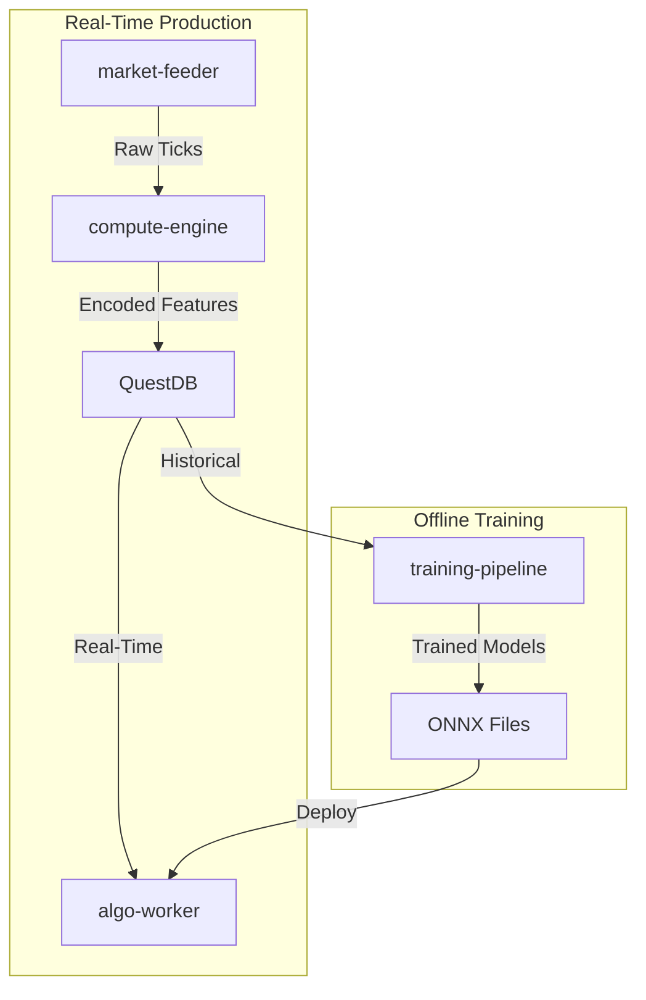

# Training Pipeline Architecture Update

**Date**: January 13, 2026
**Status**: Phase 1 Complete (LightGBM), Phase 2 Placeholders Created

---

## 🎯 What Changed?

### Old Architecture (Deprecated)

```
QuestDB (Raw Ticks) → training-pipeline (Feature Engineering) → Models
```

### New Architecture (Current)

```
market-feeder (Real-time) →
compute-engine (Rust/NAPI Feature Engineering) →
QuestDB (Pre-computed Features) →
training-pipeline (Model Training ONLY) →
ONNX Models
```

---

## 📁 Files Created/Updated

### Created Files

1. **`utils/sql_loader.py`** - QuestDB data loader
   - `QuestDBLoader` class
   - `load_lightgbm_features()` - Loads 33 pre-computed features
   - `load_tft_features()` - PLACEHOLDER
   - `load_lit_features()` - PLACEHOLDER
   - `get_available_date_range()` - Get QuestDB data range

2. **`pipelines/train_ensemble/nodes.py`** - Training orchestration
   - `load_training_data()` - Load from QuestDB
   - `train_lightgbm()` - LightGBM training (IMPLEMENTED)
   - `train_xgboost()` - PLACEHOLDER
   - `train_cnn_lstm()` - PLACEHOLDER
   - `train_ginn()` - PLACEHOLDER
   - `train_svm()` - PLACEHOLDER
   - `train_transformer()` - PLACEHOLDER
   - `train_tft()` - PLACEHOLDER
   - `train_lit()` - PLACEHOLDER

3. **`pipelines/train_ensemble/pipeline.py`** - Kedro pipeline definition
   - Loads data from QuestDB
   - Trains 6 TIER 1 models (1 implemented, 5 placeholders)
   - Commented out TIER 2 models (need feature schemas)

4. **`pipelines/pipeline.py`** - Main pipeline registry
   - Registers `train_ensemble` pipeline
   - Sets as default pipeline

5. **Dummy Trainer Files** (Placeholders for future implementation):
   - `models/xgboost_trainer.py`
   - `models/cnn_lstm_trainer.py`
   - `models/ginn_trainer.py`
   - `models/svm_trainer.py`
   - `models/transformer_trainer.py`
   - `models/tft_trainer.py`
   - `models/lit_trainer.py`

### Updated Files

1. **`conf/base/catalog.yml`**
   - Removed old TimescaleDB/Parquet data sources
   - Added QuestDB `lightgbm_features` dataset
   - Updated model output paths
   - Added placeholders for all models

2. **`conf/base/parameters.yml`**
   - Added `questdb_connection` string
   - Added `training_period_days` (730 = 2 years)
   - Added `symbol` parameter ("NIFTY")
   - Moved `training_config` (walk-forward validation)
   - Moved `labeling_config` (volatility-adjusted)
   - Moved `lightgbm_config` (hyperparameters)
   - Removed old feature engineering config

3. **`README.md`**
   - Complete rewrite reflecting new architecture
   - Updated data flow diagram
   - Added implementation status section
   - Added QuestDB setup instructions
   - Emphasized compute-engine dependency

4. **`models/lightgbm_trainer.py`** (Already updated earlier)
   - Updated to 33 features (from 29)
   - Added `fut_rsi_14`, `fut_macd`, `charm_atm`, `vanna_atm`

---

## 🔄 Data Flow (Complete)



### Key Insight

**Training uses EXACT same features as production** - Zero train-serve skew!

---

## 🎯 Feature Schema (LightGBM)

### 33 Features from Market State Encoder v2

**Index Breadth (6)** - Compressed from 50 NIFTY constituents:

- `pct_stocks_above_vwap`
- `pct_stocks_above_ema20`
- `weighted_return_top10`
- `advance_decline_ratio`
- `breadth_momentum_5m`
- `breadth_volatility`

**NIFTY FUTURE (9)** - Primary price discovery:

- `fut_price_vs_vwap`
- `fut_range_position`
- `fut_return_1m`
- `fut_return_5m`
- `fut_atr_percent`
- `fut_volume_zscore`
- `fut_oi_change`
- `fut_rsi_14` (NEW)
- `fut_macd` (NEW)

**Options Aggregate (11)**:

- `atm_iv`
- `atm_iv_change`
- `iv_skew`
- `gamma_atm`
- `vega_atm`
- `theta_atm`
- `pcr_oi`
- `pcr_volume`
- `max_pain_distance`
- `charm_atm` (NEW)
- `vanna_atm` (NEW)

**Volatility (4)**:

- `india_vix`
- `realized_vol_5m`
- `realized_vol_15m`
- `vol_expansion_ratio`

**Time Context (3)**:

- `minutes_from_open`
- `minutes_to_close`
- `day_of_week`

**Target** (for labeling):

- `close_price` (NIFTY FUTURE close)

---

## 🚀 Usage

### Train LightGBM Only

```bash
cd services/training-pipeline
poetry shell
kedro run --node train_lightgbm
```

### Train All Models (Placeholders log warnings)

```bash
kedro run --pipeline train_ensemble
```

### View Results

```bash
mlflow ui
# Open http://localhost:5000
```

---

## ✅ Implementation Status

### Completed

- [x] QuestDB data loader
- [x] LightGBM trainer with 33 MSE v2 features
- [x] Walk-forward validation (12 folds, purge + embargo)
- [x] Volatility-adjusted labeling
- [x] MLflow tracking
- [x] OOF prediction storage
- [x] Kedro pipeline structure

### Placeholders Created

- [ ] XGBoost trainer
- [ ] CNN-LSTM trainer
- [ ] GINN trainer
- [ ] SVM trainer
- [ ] Transformer trainer
- [ ] TFT trainer (needs TFT feature schema from compute-engine)
- [ ] LiT trainer (needs LOB tensor schema from compute-engine)
- [ ] Meta-learner (Level-1 stacking)
- [ ] ONNX export pipeline
- [ ] Backtesting pipeline

---

## 🔗 Dependencies

### Required for Training

1. **compute-engine** must be implemented with MSE feature computation
2. **market-feeder** must populate QuestDB with historical features
3. **QuestDB** must have table `lightgbm_features` with 2+ years of data

### Schema Definition

Feature schemas defined in:

- Rust: `packages/compute-engine/src/features/lightgbm.rs`
- TypeScript: Auto-generated via ts-rs
- Python: `training-pipeline/src/.../lightgbm_trainer.py::validate_features()`

---

## 📚 Next Steps

1. **Implement XGBoost trainer** (similar to LightGBM, same 33 features)
2. **Implement CNN-LSTM trainer** (reshape features as sequences)
3. **Implement GINN trainer** (graph-based)
4. **Implement SVM trainer** (RBF kernel)
5. **Implement Transformer trainer** (attention-based)
6. **Define TFT feature schema** in compute-engine
7. **Define LiT LOB tensor schema** in compute-engine
8. **Implement meta-learner** (Level-1 stacking)
9. **Implement ONNX export** pipeline
10. **Implement backtesting** pipeline with realistic costs

---

## 🔬 Key Architectural Decisions

1. **No Duplication**: Feature engineering logic defined ONCE in compute-engine (Rust)
2. **Type Safety**: Rust types → TypeScript → Python (via ts-rs)
3. **Zero Train-Serve Skew**: Training uses historical QuestDB data, production uses real-time QuestDB data
4. **Performance**: <1ms feature computation (Rust) vs 10-50ms (Python)
5. **Maintainability**: Single source of truth for feature definitions

---

**Last Updated**: January 13, 2026
**Author**: System Architecture Update
**Status**: ✅ Phase 1 Complete
